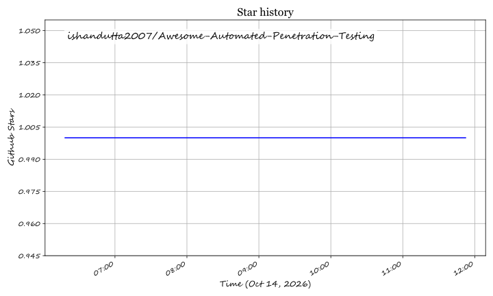

  

<h1 align="center">⚔️ Awesome Automated Penetration Testing</h1>

  

  <b>A comprehensive, curated directory of leading SaaS platforms, autonomous AI offensive agents, and battle-tested open-source tools for Automated Penetration Testing, Autonomous Exploit Validation, Multi-Stage Attack Path Chaining, and Continuous Security Testing.</b>

---

## 📖 Table of Contents

- [🎯 Overview & Scope](#-overview--scope)
- [🌐 Sector Overview & Market Dynamics](#-sector-overview--market-dynamics)
- [🏢 Enterprise SaaS & Hosted Platforms](#-enterprise-saas--hosted-platforms)
- [💻 Open-Source GitHub Projects](#-open-source-github-projects)
- [🛡️ Key Differences: Automated Pentesting vs. Vulnerability Scanning](#-key-differences-automated-pentesting-vs-vulnerability-scanning)
- [🤝 How to Contribute](#-how-to-contribute)
- [⚠️ Disclaimer & Ethical Conduct](#-disclaimer--ethical-conduct)
- [⭐ Star History](#-star-history)
- [💖 Support & Sponsoring](#-support--sponsoring)

---

## 🎯 Overview & Scope

Traditional vulnerability scanning and static security tools flood SecOps and engineering teams with theoretical vulnerabilities and uncontextualized alert fatigue. **Automated Penetration Testing** and **Autonomous Security Validation** revolutionize offensive security by autonomously discovering, validating, and chaining vulnerabilities into end-to-end exploitable attack paths—proving verifiable business impact rather than speculative risk.

This repository tracks top-tier commercial **SaaS/PTaaS platforms** and active **open-source repositories** across:
- 🤖 **Autonomous AI Agents & Copilots**: Multi-agent LLM systems dynamically generating proof-of-concept (PoC) exploits.
- 🔗 **Attack Path Chaining**: Automated escalation across web apps, APIs, Active Directory, cloud IAM, and network infrastructure.
- 🔄 **Continuous Exposure Validation & BAS**: Breach and Attack Simulation (BAS) validating detection defenses against real-time MITRE ATT&CK tactics.

---

## 🌐 Sector Overview & Market Dynamics

The global penetration testing and automated security validation market was valued at **$2.45 billion in 2024**, is estimated between **$2.50 billion and $3.09 billion in 2026**, and is projected to expand to **$5.24 billion by 2030**, reflecting a vigorous compound annual growth rate (**CAGR of 14.2% – 18.7%**).

The sector is currently **moderately to highly fragmented** rather than a winner-take-all monopoly: established enterprise PTaaS leaders and cybersecurity giants coexist alongside pioneering autonomous validation platforms (such as Pentera and Horizon3.ai) and fast-moving agentic AI startups (like XBOW and Equixly). This fragmentation is sustained by disparate customer requirements—ranging from compliance mandates (PCI DSS 4.0, DORA, FedRAMP) and zero-trust cloud architectures to strict human-in-the-loop regulatory guardrails that prevent any single provider from dominating the offensive security landscape.

---

## 🏢 Enterprise SaaS & Hosted Platforms

The table below catalogs premier commercial SaaS, PTaaS, and autonomous security validation platforms. Companies are sorted in **descending order by company size (Valuation / Revenue)**.

| Platform / Vendor 🏢 | Company Size (Valuation / Revenue) 📈 | Core Capabilities & Autonomous Focus 🎯 | Specific Starting Tier Pricing 💰 | Specific Free Tier / Trial Limits ⏳ |
| :--- | :--- | :--- | :--- | :--- |
| **[Horizon3.ai NodeZero](https://horizon3.ai/)** | **$2.0B+ Valuation** *(Raised $250M Series E; ~$50M+ ARR)* | Production-safe autonomous pentesting across cloud, internal network, web apps, and Active Directory; chains deterministic exploits into full attack paths. | **$15,000 / year** *(Core Tier: unlimited autonomous tests within defined host scope, ~$50/asset)* | **30-Day Free Trial** *(Requires corporate domain email; includes 1 full autonomous pentest assessment; transitions to read-only reporting)* |
| **[XBOW](https://xbow.com/)** | **$1.0B+ Valuation** *(Unicorn; $270M+ raised from Sequoia, Altimeter & NVentures)* | Autonomous agentic AI security researcher discovering 0-days and executing full-chain exploits across web apps, APIs, desktop apps, and firmware. | **$4,000 / assessment** *(Lightspeed Plus tier for single app testing; $8,000 for Lightspeed Premium)* | **14-Day Enterprise Evaluation** *(Includes 1 target web app assessment and PoC exploit demonstration upon scoping verification)* |
| **[Pentera](https://pentera.io/)** | **$1.0B Valuation** *(Unicorn; Series C led by K1; ~$42M+ ARR)* | Automated security validation platform combining deterministic attack emulation with agentic AI across internal networks, external surfaces, and cloud identities. | **$35,000 / year** *(Pentera Core baseline annual contract for internal network exposure validation)* | **14-Day Guided Proof-of-Concept (PoC)** *(Includes 1 external attack surface validation scan scoped up to 1 corporate CIDR/domain)* |
| **[NetSPI](https://www.netspi.com/)** | **~$1.0B Valuation** *(Backed by $410M PE investment from KKR; ~$100M+ ARR)* | Enterprise Penetration Testing as a Service (PTaaS), Attack Surface Management (ASM), and automated breach & attack simulation with expert human validation. | **$7,000 / year** *(Baseline Attack Surface Management tier; PTaaS manual/automated hybrid starts at ~$15,000/engagement)* | **14-Day Enterprise Pilot** *(Sales-qualified evaluation scoped to 1 application or 1 external IP/domain range with platform telemetry)* |
| **[Synack](https://www.synack.com/)** | **~$500M Valuation** *(Raised $180M+; ~$50M–$80M ARR)* | Crowdsourced offensive security platform combining continuous autonomous scanning (Sara AI) with vetted Synack Red Team (SRT) ethical hackers. | **$4,000 / test** *(Sara AI Pentest; full continuous testing platform subscriptions start at $5,060/year + testing credits)* | **Free Forever Basic Platform Tier** *(Free $0 platform access for vulnerability intake, analytics & triage; live penetration testing credits purchased separately)* |
| **[Cobalt](https://cobalt.io/)** | **~$200M+ Valuation** *(Raised $67M+; ~$40M+ ARR)* | Pentest as a Service (PTaaS) platform uniting automated vulnerability scanning with on-demand human security researchers for rapid agile testing. | **$3,500 / pentest** *(Autonomous Pentest tier; continuous enterprise PTaaS platform subscriptions start at $15,000/year)* | **14-Day Guided Preview** *(Includes provisioned dashboard access and 1 preliminary external attack surface & DAST discovery scan)* |
| **[BreachLock](https://www.breachlock.com/)** | **~$50M Valuation** *(Series A funded; ~$10M–$15M ARR)* | Hybrid PTaaS platform combining AI-driven automated vulnerability scanning with certified human penetration testing for compliance (SOC 2, ISO 27001). | **$2,500 / assessment** *(1-Time Security Validation; annual continuous security validation programs start at $5,000/year)* | **14-Day Free Evaluation** *(Includes automated external attack surface discovery scan for up to 1 corporate domain)* |
| **[Equixly](https://equixly.com/)** | **~$45M Valuation** *(Raised €11.5M Series A in Dec 2025 led by 33N & AIC)* | Agentic AI API penetration testing platform that reverse-engineers business logic and autonomously discovers and exploits API vulnerabilities. | **€4,999 (~$5,400) / test** *(Complete one-off AI API pentest with remediation guidance; custom annual continuous platform licenses)* | **14-Day Interactive Pentest Demo** *(Autonomous discovery and testing scoped to 1 OpenAPI / Swagger collection with executive report generation)* |
| **[Software Secured](https://www.softwaresecured.com/)** | **~$5M ARR** *(Bootstrapped & profitable)* | Boutique application security and continuous PTaaS (Sherloq) designed for high-growth B2B SaaS and AI platforms requiring verifiable SOC 2 assurance. | **$5,000 / engagement** *(Scoped single application assessment; continuous Sherloq PTaaS subscription starts at $15,000/year)* | **30-Minute Threat & Scope Assessment** *(Free architecture consultation, scope calibration, and sample vulnerability audit report)* |
| **[Penligent](https://penligent.ai/)** | **~$3M–$5M Valuation** *(Seed stage / early venture)* | Autonomous AI agent for offensive security executing reconnaissance, WAF evasion, payload crafting, and multi-tool exploit reproduction. | **$39.92 / month** *(Pro Tier billed annually at $479/yr; includes 6,000 monthly execution credits for ~5 targets)* | **Free Forever Tier ($0/mo)** *(Includes 200 monthly credits, automated asset discovery, port/fingerprint probing, and PDF/Markdown reports)* |

---

## 💻 Open-Source GitHub Projects

Explore the open-source offensive security, automated exploitation, and vulnerability assessment frameworks. All projects are sorted in **descending order by GitHub Stars_Count** ⭐.

1. **[Strix](https://github.com/usestrix/strix)**  — **68,400+ ⭐** `Apache-2.0`  
   Autonomous AI-native penetration testing framework. Deploys collaborating multi-agent teams that dynamically execute code, probe OWASP Top 10 vulnerabilities, and validate every finding with a working proof-of-concept (PoC) exploit in sandboxed Docker containers.

2. **[Metasploit Framework](https://github.com/rapid7/metasploit-framework)**  — **39,100+ ⭐** `BSD-3-Clause`  
   The industry-standard exploitation framework providing the world's largest public database of quality-assured exploits, shellcodes, and automated post-exploitation pivoting modules.

3. **[sqlmap](https://github.com/sqlmapproject/sqlmap)**  — **38,600+ ⭐** `GPL-2.0`  
   Automatic SQL injection and database takeover engine supporting database fingerprinting, data extraction, direct OS file system access, and out-of-band shell execution.

4. **[Trivy](https://github.com/aquasecurity/trivy)**  — **38,400+ ⭐** `Apache-2.0`  
   Comprehensive, fast automated vulnerability and misconfiguration scanner for container images, Kubernetes clusters, Git repositories, virtual machine disks, and cloud environments.

5. **[Nuclei](https://github.com/projectdiscovery/nuclei)**  — **32,000+ ⭐** `MIT`  
   Fast, highly customizable vulnerability scanner powered by community-curated YAML templates. Features AI-assisted template drafting and zero-day exposure scanning across massive asset scopes.

6. **[PentAGI](https://github.com/vxcontrol/pentagi)**  — **28,300+ ⭐** `MIT`  
   Fully autonomous AI agent framework capable of executing end-to-end offensive penetration testing campaigns, hypothesis testing, and vulnerability chaining.

7. **[PEASS-ng (LinPEAS / WinPEAS)](https://github.com/peass-ng/PEASS-ng)**  — **20,600+ ⭐** `GPL-3.0`  
   Automated privilege escalation scripts for Linux, Windows, and macOS searching for misconfigurations, weak permissions, stored credentials, and exploitable kernel paths.

8. **[Katana](https://github.com/projectdiscovery/katana)**  — **17,600+ ⭐** `MIT`  
   Next-generation crawling and spidering framework with headless browser navigation and automated endpoint mapping for deep attack surface discovery.

9. **[ffuf](https://github.com/ffuf/ffuf)**  — **16,800+ ⭐** `MIT`  
   Extremely fast web fuzzer written in Go for discovering hidden directories, parameters, virtual hosts, and API routing vulnerabilities.

10. **[OWASP ZAP](https://github.com/zaproxy/zaproxy)**  — **15,900+ ⭐** `Apache-2.0`  
    The flagship OWASP open-source web application security scanner (ZAP by Checkmarx), offering automated vulnerability scans, CI/CD integrations, and deep intercepting proxy features.

11. **[PentestGPT](https://github.com/GreyDGL/PentestGPT)**  — **15,900+ ⭐** `MIT`  
    LLM-powered interactive agentic copilot for penetration testers. Maintains an evolving task tree of engagements, analyzes complex tool outputs, and suggests optimal attack vectors.

12. **[Amass](https://github.com/owasp-amass/amass)**  — **15,300+ ⭐** `Apache-2.0`  
    In-depth attack surface mapping and network external asset discovery framework using active recon and open-source OSINT data gathering.

13. **[Prowler](https://github.com/prowler-cloud/prowler)**  — **15,000+ ⭐** `Apache-2.0`  
    Open-source cloud security scanner for AWS, Azure, GCP, and Kubernetes performing automated security audits, incident response assessments, and continuous compliance checks.

14. **[John the Ripper](https://github.com/openwall/john)**  — **13,700+ ⭐** `GPL-2.0`  
    High-performance offline password auditing and recovery utility supporting hundreds of hash and cipher formats across diverse architectures.

15. **[Nmap](https://github.com/nmap/nmap)**  — **13,700+ ⭐** `Nmap Public Source License`  
    The legendary network discovery and port auditing tool featuring the Nmap Scripting Engine (NSE) for automated vulnerability detection and service exploitation.

16. **[Grype](https://github.com/anchore/grype)**  — **13,000+ ⭐** `Apache-2.0`  
    Rapid, automated vulnerability scanner for container images and file systems developed by Anchore.

17. **[THC-Hydra](https://github.com/vanhauser-thc/thc-hydra)**  — **12,300+ ⭐** `AGPL-3.0`  
    Very fast parallelized network login cracker supporting over 50 protocols (SSH, FTP, HTTP, SMB, RDP, databases).

18. **[Sn1per](https://github.com/1N3/Sn1per)**  — **11,400+ ⭐** `Custom`  
    Automated attack surface management platform and penetration testing orchestrator executing automated multi-tool recon and exploitation pipelines.

19. **[Nikto](https://github.com/sullo/nikto)**  — **10,700+ ⭐** `GPL-2.0`  
    Web server vulnerability scanner checking for 6,700+ dangerous files/programs, outdated server versions, and web misconfigurations.

20. **[BloodHound](https://github.com/BloodHoundAD/BloodHound)**  — **10,600+ ⭐** `GPL-3.0`  
    Graph-theory tool using graph analysis to reveal hidden, unintended, and exploitable relationship paths in Active Directory and Azure/Entra ID architectures.

21. **[Wireshark](https://github.com/wireshark/wireshark)**  — **10,000+ ⭐** `GPL-2.0`  
    The premier network protocol analyzer for deep live capture inspection, micro-level packet dissection, and traffic auditing.

22. **[WPScan](https://github.com/wpscanteam/wpscan)**  — **9,800+ ⭐** `Custom`  
    Black box WordPress vulnerability scanner for automated discovery of vulnerable plugins, themes, and WordPress core security flaws.

23. **[Faraday](https://github.com/infobyte/faraday)**  — **6,700+ ⭐** `GPL-3.0`  
    Collaborative open-source vulnerability management workspace that ingests, deduplicates, and manages findings across 80+ offensive tools.

24. **[AutoRecon](https://github.com/Tib3rius/AutoRecon)**  — **6,100+ ⭐** `GPL-3.0`  
    Multi-threaded network reconnaissance tool that automates port scanning, service enumeration, and targeted tool triggering.

25. **[Recon-ng](https://github.com/lanmaster53/recon-ng)**  — **5,900+ ⭐** `GPL-3.0`  
    Modular, Python-based web reconnaissance framework with an interactive shell for automated OSINT gathering and external threat surface mapping.

26. **[Commix](https://github.com/commixproject/commix)**  — **5,800+ ⭐** `GPL-3.0`  
    Automated tool for detecting and exploiting command injection vulnerabilities and converting command execution flaws into interactive root shells.

27. **[OWASP Nettacker](https://github.com/OWASP/Nettacker)**  — **5,600+ ⭐** `Apache-2.0`  
    Automated penetration testing and vulnerability discovery framework from OWASP designed for network exploration and compliance reporting.

28. **[Pacu](https://github.com/RhinoSecurityLabs/pacu)**  — **5,300+ ⭐** `BSD-3-Clause`  
    Open-source AWS exploitation framework created by Rhino Security Labs for testing cloud privilege escalation paths and IAM misconfigurations.

29. **[CyberStrike](https://github.com/CyberStrikeus/CyberStrike)**  — **3,100+ ⭐** `AGPL-3.0`  
    Autonomous AI pentesting platform providing automated web and network testing workflows with minimal manual intervention.

30. **[CloudFox](https://github.com/BishopFox/cloudfox)**  — **2,600+ ⭐** `MIT`  
    Bishop Fox's command-line tool for situational awareness and rapid identification of exploitable attack paths in cloud environments.

31. **[DeepSec](https://github.com/Unclecheng-li/DeepSec)**  — **480+ ⭐** `MIT`  
    Autonomous AI pentesting tool using reinforcement learning and agentic feedback loops for automated web application penetration testing.

---

## 🛡️ Key Differences: Automated Pentesting vs. Vulnerability Scanning

| Dimension 📐 | Vulnerability Scanning (DAST / Nessus / Qualys) 🔍 | Automated Penetration Testing (Horizon3, Pentera, Strix) ⚔️ |
| :--- | :--- | :--- |
| **Objective** | Flags potential CVEs based on software version headers and banners. | Proves exploitability by executing real, safe exploit payloads. |
| **Attack Chaining** | Evaluates isolated vulnerabilities independently. | Automatically chains minor flaws (e.g., SSRF + leaked token + IAM escalation). |
| **False Positives** | High (often 40%–60% non-exploitable noise). | Near-zero (findings require verifiable Proof-of-Concept execution). |
| **Business Impact** | Theoretical risk scores (CVSS base scores). | Demonstrated operational risk (e.g., Domain Admin takeover, DB data dump). |
| **Frequency** | Periodic scheduled scans (weekly/monthly). | Continuous automated validation integrated with CI/CD and production telemetry. |

---

## 🤝 How to Contribute

Contributions from security researchers, red teamers, and software developers are warmly welcome!

1. 🍴 **Fork the repository** to your GitHub account.
2. 🌿 **Create a new branch** (`git checkout -b feature/add-new-tool`).
3. 📝 **Add or update entries** following the established format:
   - For **SaaS products**: include company name, link, valuation/revenue, capabilities, starting tier price, and specific free tier/trial limits.
   - For **Open-Source tools**: include project link, Stars_Count badge (`https://img.shields.io/github/stars/<owner>/<repo>?style=social&color=white` linking to the stargazers page), license, and an accurate 1–2 sentence description. Maintain descending order by Stars_Count.
4. 🚀 **Submit a Pull Request** with a concise summary of the addition or update.

---

## ⚠️ Disclaimer & Ethical Conduct

- 🔒 **Authorized Testing Only**: Automated penetration testing tools must only be run against networks, applications, and environments you explicitly own or have **written authorization** to test. Unauthorized penetration testing is illegal under the Computer Fraud and Abuse Act (CFAA), the UK Computer Misuse Act, and international cyber legislation.
- 🧪 **Autonomous Limitations**: While autonomous offensive agents drastically accelerate validation, human expertise remains vital for complex business-logic flaws, authorization bypasses, and nuanced architectural design evaluations.
- 🛡️ **Defensive Sovereignty**: Ensure that traces, API keys, and internal vulnerability findings generated during AI-driven tests are handled in compliance with your organization's data protection and confidentiality mandates.

---

## ⭐ Star History

---

## 💖 Support & Sponsoring

Thank you for visiting and supporting **Awesome Automated Penetration Testing**! If you find this curated collection useful for your offensive security operations, red team exercises, or compliance readiness:

- ⭐ **Star this repository** to help other security professionals discover it!
- 🍴 **Fork and share** with your SecOps and AppSec teams.
- ☕ **Sponsor the Project**: If you would like to support ongoing research, curation, and maintenance of open offensive security resources, please consider buying a coffee via the [GitHub Sponsors Dashboard](https://github.com/sponsors/ishandutta2007).

## ⭐ Star History

<a href="https://star-history.com/#ishandutta2007/Awesome-Automated-Penetration-Testing&Timeline" align="center">
  <picture>
    <source media="(prefers-color-scheme: dark)" srcset="assets/ishandutta2007_Awesome-Automated-Penetration-Testing_growth.svg">
    
  </picture>
</a>
